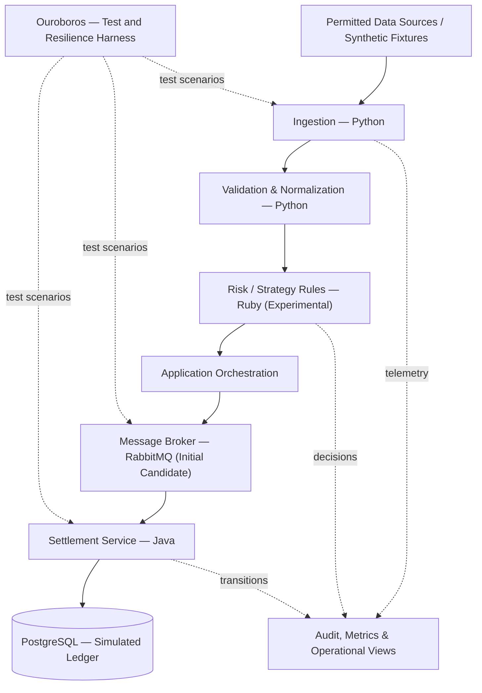
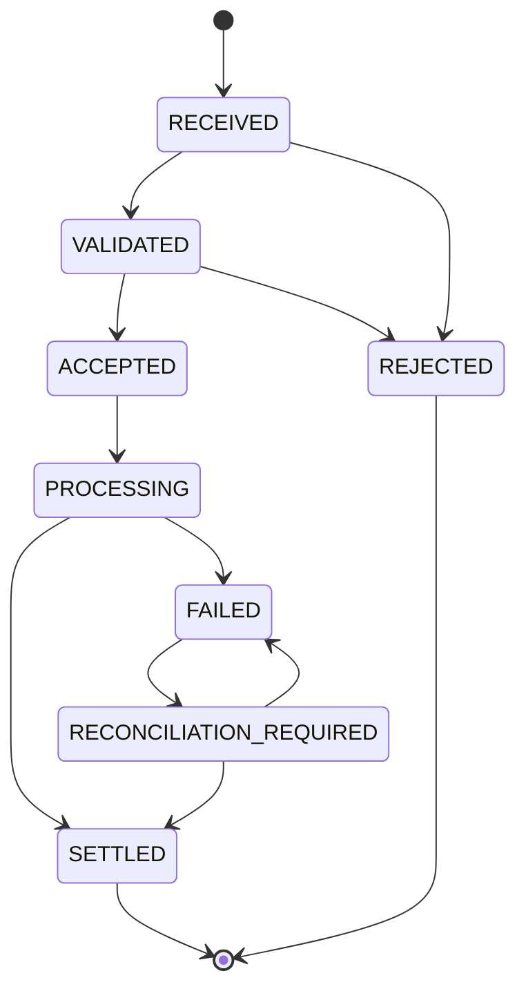
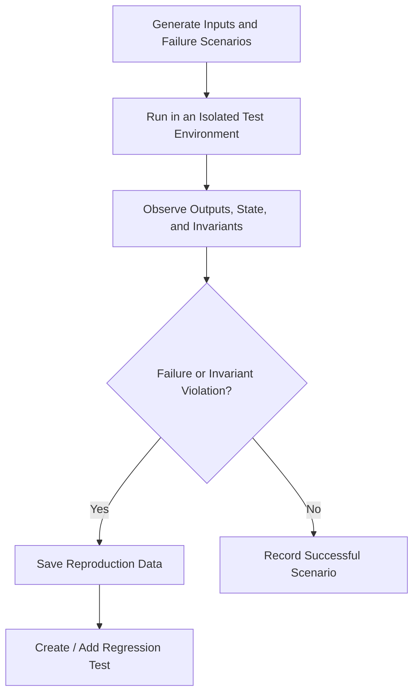

# KnotPay — Polyglot Transaction Processing & Resilience Lab

<p align="center">
  
  
  
  
</p>

<p align="center">
  
  
  
  
  
  
</p>

**An experimental platform for event-driven processing, transaction integrity, concurrency control, and fault-tolerant execution.**

<sub>Technology badges describe the intended project direction and workstreams; they do not certify that every component is implemented or runnable.</sub>

> KnotPay explores how independently developed services can exchange validated business events and process simulated financial operations safely under retries, concurrency, and partial failure.

**Project status:** Research prototype / architectural work in progress. The repository contains several component workspaces, but this README does not claim that the complete target architecture is implemented or production-ready. See [Implementation Status](#implementation-status) before assuming that a component or command is available.

---

## Table of Contents

- [1. Overview](#1-overview)
- [2. The Problem](#2-the-problem)
- [3. Project Goals](#3-project-goals)
- [4. Design Principles](#4-design-principles)
- [5. Architecture at a Glance](#5-architecture-at-a-glance)
- [6. Runtime Responsibilities](#6-runtime-responsibilities)
- [7. Transaction Processing Model](#7-transaction-processing-model)
- [8. Consistency, Idempotency, and Delivery](#8-consistency-idempotency-and-delivery)
- [9. Ouroboros — Resilience Testing Engine](#9-ouroboros--resilience-testing-engine)
- [10. Testing and Fault Models](#10-testing-and-fault-models)
- [11. Security and Operational Boundaries](#11-security-and-operational-boundaries)
- [12. Repository Layout](#12-repository-layout)
- [13. Implementation Status](#13-implementation-status)
- [14. Technical Stack](#14-technical-stack)
- [15. Development Roadmap](#15-development-roadmap)
- [16. Building, Running, and Testing](#16-building-running-and-testing)
- [17. Non-Goals and Current Limitations](#17-non-goals-and-current-limitations)
- [18. Contributing](#18-contributing)
- [19. License](#19-license)
- [20. Author](#20-author)

---

## 1. Overview

KnotPay is an independent systems-engineering project focused on the boundaries between data ingestion, business-rule evaluation, asynchronous messaging, and transactional persistence.

The project investigates a polyglot architecture in which services can use different runtimes when there is a clear engineering reason to do so. Its central challenge is not simply moving data quickly. It is preserving correctness when messages are duplicated, workers restart, requests arrive concurrently, or a dependency becomes temporarily unavailable.

The initial domain is **simulated opportunity evaluation and settlement**. External data may be collected from permitted sources or generated synthetically, normalized into a canonical representation, evaluated against configurable rules, and passed to a settlement service that records simulated operations in PostgreSQL.

KnotPay is not currently presented as a payment processor, brokerage, arbitrage service, or production financial platform. No real funds should be moved through this project.

### Why “KnotPay”?

The name combines two ideas:

- **Knot:** the point where separate strands are joined and held together. In this project, those strands represent independent services, event streams, and transaction boundaries.
- **Pay:** the simulated settlement domain used to study transactional correctness and ledger-style persistence.

KnotPay explores the engineering required to connect data and decisions to a durable, auditable transaction record without assuming that a distributed workflow is one global ACID transaction.

---

## 2. The Problem

Event-driven systems often cross several independent failure boundaries:

- A data source may change or become unavailable.
- A worker may crash after publishing an event but before recording its local result.
- A broker may redeliver a message.
- Two consumers may attempt to process the same business operation concurrently.
- A database transaction may commit while the caller loses the response.
- A downstream dependency may time out even though the operation eventually succeeded.

These situations create questions that a reliable system must answer:

1. Can the same event be delivered more than once without repeating its business effect?
2. Can concurrent requests attempt the same operation without corrupting the ledger?
3. Can the system recover after a process or network failure?
4. Can an operator reconstruct what happened and why?
5. Can the system prove its invariants through repeatable tests?

KnotPay uses these questions as the basis for its architecture and testing strategy.

---

## 3. Project Goals

The project aims to explore and demonstrate the following engineering capabilities:

### Transaction integrity

Model business operations as explicit state transitions and persist them using database transactions and constraints.

### Idempotent event handling

Ensure that duplicate delivery of the same logical event does not create duplicate settlement effects.

### Concurrency control

Exercise simultaneous requests and workers while preserving defined invariants.

### Reliable event processing

Study message acknowledgement, retry behavior, dead-letter handling, and the relationship between database commits and message publication.

### Polyglot service boundaries

Evaluate interoperability between runtimes through explicit contracts rather than using multiple languages for appearance alone.

### Resilience testing

Use fuzzing, concurrency stress, and controlled fault injection to expose invalid states and recovery defects.

### Auditable behavior

Preserve enough structured information to explain the lifecycle of a simulated operation.

---

## 4. Design Principles

1. **Correctness before throughput.** Performance optimization must not weaken transaction invariants.
2. **Explicit boundaries.** Each service must have a defined responsibility, input contract, output contract, and failure model.
3. **At-least-once delivery is expected.** Consumers must tolerate duplicate messages unless a stronger delivery guarantee is actually established and tested.
4. **Database constraints are part of the design.** Critical invariants should not exist only in application code.
5. **No hidden financial side effects.** The initial system uses synthetic data and simulated settlement only.
6. **Observable failure.** Errors, retries, state transitions, and recovery decisions should be inspectable.
7. **Polyglot only when justified.** A runtime is retained when it provides a useful learning or operational boundary, not merely to increase the language count.

---

## 5. Architecture at a Glance

The following diagram describes the **target architecture**. It is not a statement that every connection or service is currently implemented.



### Architectural boundaries

| Boundary | Main responsibility | Main concern |
|---|---|---|
| Ingestion | Collect source data or load fixtures | Source reliability, rate limits, input quality |
| Normalization | Validate and produce canonical records | Schema correctness, currency and unit handling |
| Risk evaluation | Apply deterministic business rules | Reproducibility and explainable decisions |
| Orchestration | Coordinate workflow and publish events | Durable handoff and traceability |
| Messaging | Transport events between services | Redelivery, ordering, retries, dead letters |
| Settlement | Enforce transaction state and persist effects | Idempotency, concurrency, database invariants |
| Observability | Expose lifecycle and failure context | Auditability and diagnosis |
| Ouroboros | Exercise components and system invariants | Reproducible failures and regression coverage |

### Simplified data flow

```text
Authorized source / fixture
        ↓
Python ingestion
        ↓
Python validation and normalization
        ↓
Ruby strategy evaluation (optional experiment)
        ↓
Application orchestration
        ↓
Message broker
        ↓
Java settlement service
        ↓
PostgreSQL simulated ledger
```

The first end-to-end milestone should use the smallest number of services necessary to prove the transaction lifecycle. Optional runtimes should not block that milestone.

---

## 6. Runtime Responsibilities

The repository explores multiple runtimes. The table below documents the **intended specialization**, not verified implementation or production suitability.

| Component | Intended runtime | Intended responsibility | Status in the target design |
|---|---|---|---|
| Ingestion | Python 3.12 / Scrapy | Fetch permitted sources and extract structured records | Core workstream |
| Validation | Python / Pydantic; Pandas where useful | Validate schemas, normalize values, and prepare canonical records | Core workstream |
| Strategy | Ruby 3.3 | Experiment with a small business-rule engine | Optional / experimental |
| Orchestration | Existing application service; Laravel may remain an adapter | Coordinate workflow, audit decisions, and publish events | To be simplified and verified |
| Messaging | RabbitMQ initially | Asynchronous event transport | Initial broker candidate; Kafka is not required for the MVP |
| Settlement | Java 21 / Spring Boot | Model transaction states and persist simulated settlement | Core workstream |
| Persistence | PostgreSQL | Durable records, constraints, and transaction isolation | Core workstream |
| Resilience tests | Go | Concurrent load and race-oriented test scenarios | Test workstream |
| Experimental runtime | Mojo | Language and performance experiments | Research only; not required by the MVP |
| Dashboard | Vue.js | Optional read-only operational interface | Optional |

### Runtime selection policy

The project should not run both RabbitMQ and Kafka simply to list both technologies. Start with one broker and document why it is sufficient. Reconsider the choice only when a measured requirement justifies another system.

Likewise, Laravel should not sit in the critical transaction path by default. It may be retained as an optional control-plane or dashboard backend if the implementation demonstrates a clear benefit.

---

## 7. Transaction Processing Model

The settlement service is intended to model a simulated transaction as an explicit finite-state machine (FSM).

An illustrative state model is:



This is a proposed model. The final states and allowed transitions must be defined by the settlement implementation and enforced in code and storage.

### Transaction invariants to test

- A transaction identifier refers to one logical operation.
- A settled operation cannot be settled a second time.
- A rejected operation cannot transition directly to `SETTLED`.
- A state transition must be validated against the current persisted state.
- Concurrent attempts must not violate uniqueness or ledger invariants.
- A failed operation must remain distinguishable from an operation whose outcome is unknown.

The project should keep a clear distinction between a local database transaction and a workflow that spans services.

---

## 8. Consistency, Idempotency, and Delivery

A database transaction can provide atomicity within one database boundary. It does not make an entire workflow across a broker, several services, and external systems one global ACID transaction.

KnotPay's target design therefore investigates the following patterns.

### Idempotency keys

Each logical operation should carry a stable idempotency key. The settlement database should enforce uniqueness for the relevant scope, rather than trusting application-level checks alone.

### Transactional Outbox

When a service must commit local state and publish an event, an outbox record can be written in the same database transaction as the business change. A separate publisher can deliver the event to the broker and mark it as published.

### Consumer Inbox / Deduplication

A consumer can record processed event identifiers under a unique constraint. The deduplication record and the resulting business effect should be committed in the same local transaction.

### Row-level locking

PostgreSQL row locks, including `SELECT ... FOR UPDATE`, may be appropriate when a transaction must serialize updates to an existing row. They are not a substitute for unique constraints, correct isolation choices, or idempotent consumers.

### Retry and dead-letter handling

Retries should be bounded, observable, and appropriate to the failure type. Permanently invalid messages should not be retried indefinitely. A dead-letter path should preserve enough context for investigation and controlled replay.

### Delivery semantics

The initial design assumes that broker delivery may be repeated. The goal is to make business effects idempotent and recoverable. Do not describe the system as providing end-to-end “exactly-once processing” unless the specific scope and mechanism are demonstrated by tests.

---

## 9. Ouroboros — Resilience Testing Engine

**Ouroboros** is the proposed adversarial testing and resilience layer for KnotPay.

Its purpose is not to autonomously attack production systems, discover zero-day vulnerabilities by promise, or inject runtime “vaccines.” It is a controlled test harness for finding defects in parsers, state machines, concurrency boundaries, and recovery workflows.

The name references the Ouroboros, the serpent that consumes its own tail. In this project, the symbol represents a feedback loop in which failures found during testing become reproducible regression cases.

### Core capabilities under consideration

| Capability | Purpose |
|---|---|
| Input fuzzing | Generate malformed, unexpected, and boundary-value inputs |
| Schema/property testing | Check that records obey validation rules and invariants |
| State-machine testing | Explore valid and invalid transaction transitions |
| Concurrency stress | Exercise simultaneous requests and duplicate event delivery |
| Fault injection | Simulate timeouts, unavailable dependencies, and interrupted workers |
| Failure reproduction | Preserve seeds, inputs, and execution context for repeatability |
| Regression corpus | Turn confirmed defects into permanent test cases |

### Ouroboros feedback loop



### Safety boundary

Ouroboros must run against synthetic data, test databases, local services, or explicitly authorized environments. It must not mutate live customer data, send uncontrolled traffic to third-party services, or execute destructive scenarios against production infrastructure.

A discovered failure should produce a reproducible test case and an engineering investigation. It should not automatically modify production filters or security rules.

---

## 10. Testing and Fault Models

The testing strategy should verify both component behavior and cross-service invariants.

### Unit tests

Validate parsing, normalization, business rules, state transitions, and error handling in isolation.

### Integration tests

Validate service contracts, persistence behavior, broker publication and consumption, and the relationship between message handling and database commits.

### Concurrency tests

Exercise cases such as:

- Two requests using the same idempotency key.
- Two consumers receiving the same logical event.
- Multiple workers attempting to update the same transaction.
- A worker restarting while a message is in flight.
- A response being lost after a database commit.

### Fault-injection scenarios

Simulate controlled failures such as:

- Broker unavailable before publication.
- Broker connection lost after publication.
- Database unavailable before commit.
- Worker terminated before acknowledgement.
- Delayed or duplicated messages.
- Invalid or out-of-order events.

### Evidence to retain

A useful test report should include the test seed or input, environment, expected invariant, observed result, and reproduction steps. Performance claims should include the hardware, software versions, workload, duration, and measurement method.

---

## 11. Security and Operational Boundaries

KnotPay is an experimental software project. Its simulated transaction model is not a substitute for the controls required by a regulated financial system.

### Data collection

Use synthetic fixtures, documented public datasets, or sources whose terms explicitly permit the intended access. Respect rate limits, access policies, and applicable terms. Proxy rotation must not be used to evade restrictions or access controls.

### Secrets

Do not commit API keys, credentials, payment tokens, private datasets, or production connection strings. Use local environment configuration and provide a sanitized example file only when the application supports it.

### Simulated settlement

The initial project must not initiate real payments, place real orders, or connect to banking rails. Settlement records should be clearly identified as simulated.

### Least privilege

Services should receive only the permissions required for their role. Database credentials and broker permissions should be scoped per service where practical.

### Auditability

Important state transitions, rejected operations, retry decisions, and administrative actions should be recorded without exposing secrets or unnecessary personal data.

### Failure handling

A failure in an analysis or monitoring component must not silently authorize a financial operation. Uncertain outcomes should be represented explicitly and handled through reconciliation rather than guessed.

---

## 12. Repository Layout

The following top-level directories are visible in the repository. Their internal implementation and readiness must be evaluated separately.

```text
KnotPay/
├── .docker/                  # Container-related workspace
├── 1-ingestion-stream/       # Ingestion pipeline workspace
├── 2-settlement-engine/      # Settlement engine workspace
├── core-mojo/                # Experimental Mojo workspace
├── dashboard/               # Dashboard workspace
├── engine-ruby/              # Ruby strategy / rules workspace
├── scraper-python/           # Python scraping workspace
├── scripts/
│   └── go-stress-test/       # Go concurrency / stress-test workspace
├── .gitignore
├── docker-compose.yml        # Currently empty; not a runnable stack definition
└── README.md
```

The repository also contains similarly named ingestion-related workspaces. Before consolidating or moving code, compare their contents and histories to identify the canonical implementation. Do not delete a directory solely because its name overlaps another directory.

---

## 13. Implementation Status

KnotPay is an evolving prototype. The presence of a directory or a technology name in a design document does not prove that a runnable service exists.

Based on the publicly visible repository root during this review:

| Area | Repository evidence | Status statement |
|---|---|---|
| Ingestion | `scraper-python/` and `1-ingestion-stream/` directories exist | Implementation needs code-level verification |
| Settlement | `2-settlement-engine/` directory exists | Implementation needs code-level verification |
| Ruby strategy | `engine-ruby/` directory exists | Implementation needs code-level verification |
| Mojo experiment | `core-mojo/` directory exists | Research workspace; implementation needs verification |
| Dashboard | `dashboard/` directory exists | Implementation needs code-level verification |
| Go stress tests | `scripts/go-stress-test/` directory exists | Test workspace; execution needs verification |
| Container orchestration | Root `docker-compose.yml` is empty | No root-level Compose stack is currently documented as runnable |

No benchmark, test-coverage percentage, end-to-end transaction guarantee, or production-readiness claim is made here.

Update this section only after checking the actual source, dependencies, entry points, and repeatable test results. Use these labels consistently:

- **Implemented:** code exists and the stated behavior has been exercised by a repeatable test.
- **In Progress:** implementation exists but is incomplete or not yet fully validated.
- **Planned:** approved work that has not been implemented.
- **Research:** an exploratory direction without a committed implementation contract.

---

## 14. Technical Stack

The following technologies are part of the project direction or existing repository workspaces. Exact versions and compatible combinations must be pinned in the relevant component manifests.

| Technology | Intended use |
|---|---|
| Python | Ingestion, parsing, validation, and data normalization |
| Scrapy | Structured crawling where source access is permitted |
| Pydantic | Input and event schema validation |
| Pandas / NumPy | Data analysis where vectorized operations are useful |
| Ruby | Experimental strategy and rule evaluation |
| PHP / Laravel | Optional orchestration or control-plane integration |
| Java | Transaction lifecycle and settlement service |
| PostgreSQL | Durable transaction and audit persistence |
| RabbitMQ | Initial candidate for asynchronous event transport |
| Go | Concurrent load generation and stress testing |
| Mojo | Experimental runtime and performance research |
| Vue.js | Optional operational dashboard |
| Docker | Reproducible local development environments, once configured |

The project should minimize required dependencies for the first working end-to-end path. Kafka, Mojo, Laravel, and the dashboard are not prerequisites for proving the initial transaction invariants.

---

## 15. Development Roadmap

The roadmap prioritizes a small, demonstrable transaction path before expanding the number of runtimes.

### Phase 1 — Transaction Processing Core

- Define the transaction data model.
- Implement the settlement state machine.
- Persist simulated operations in PostgreSQL.
- Add database constraints for critical invariants.
- Test commit, rollback, and invalid transitions.

**Milestone:** a repeatable local test proving that valid simulated operations are persisted and invalid transitions are rejected.

### Phase 2 — Reliable Event Delivery

- Introduce one message broker, initially RabbitMQ if it matches the current implementation.
- Define versioned event contracts.
- Add idempotency handling.
- Investigate Transactional Outbox and Consumer Inbox patterns.
- Add bounded retry and dead-letter handling.

**Milestone:** duplicate event delivery does not duplicate the simulated business effect.

### Phase 3 — Concurrency and Consistency

- Add concurrent request and consumer tests.
- Test row-level locking and unique constraints.
- Exercise worker restarts and lost responses.
- Document transaction isolation and recovery behavior.

**Milestone:** concurrency tests preserve documented transaction invariants.

### Phase 4 — Ouroboros Resilience Testing

- Add input fuzzing and boundary-value tests.
- Add state-machine property tests.
- Add Go-based concurrent load scenarios where useful.
- Add deterministic fault injection.
- Preserve regressions as repeatable tests.

**Milestone:** confirmed defects can be reproduced and prevented by regression tests.

### Phase 5 — Observability and Extended Polyglot Integration

- Add structured logs and useful metrics.
- Integrate optional runtime components through explicit contracts.
- Evaluate the value of Ruby strategy isolation, Laravel orchestration, Mojo experiments, and a dashboard.
- Publish reproducible performance reports.

**Milestone:** each added runtime demonstrates a measurable or educational benefit and has a documented operational cost.

---

## 16. Building, Running, and Testing

A verified, one-command development environment is not currently documented in this repository. The root `docker-compose.yml` is empty, so `docker compose up` must not be treated as a supported startup procedure.

Build and test instructions should be added per component only after verifying:

1. The required runtime and version.
2. The dependency installation command.
3. The actual application entry point.
4. Required environment variables.
5. Database and broker initialization steps.
6. The test command and expected result.

Until these steps are verified, no universal install command is advertised here.

### Minimum validation expected for the first milestone

- The settlement service starts locally.
- Database migrations or schema setup complete successfully.
- A simulated transaction can be created and read back.
- Invalid state transitions are rejected.
- A repeated request with the same idempotency key does not create a second effect.
- Tests run from a documented command and produce reproducible results.

---

## 17. Non-Goals and Current Limitations

KnotPay does not currently claim to provide:

- Real-money payment processing.
- A connection to banking rails or payment processors.
- Guaranteed profit, arbitrage, or market execution.
- Global atomicity across independent services.
- End-to-end exactly-once message delivery.
- Automatic zero-day discovery.
- An AI system that autonomously generates production security filters.
- Production-grade financial, regulatory, or compliance certification.
- Benchmark throughput or latency without published measurements.

These boundaries are intentional. The project prioritizes correctness, reproducibility, and engineering evidence over broad claims.

---

## 18. Contributing

Contributions and technical discussions are welcome as the project matures.

Please prioritize:

- Small, reviewable changes.
- Explicit service contracts.
- Reproducible tests.
- Clear failure handling.
- Database-enforced invariants.
- Security-conscious defaults.
- Documentation that matches executable behavior.

When reporting a defect, include the component, runtime version, reproduction steps, expected behavior, observed behavior, and relevant logs with secrets removed.

Open an issue through the repository's GitHub Issues page:

[https://github.com/kauand3v/KnotPay/issues](https://github.com/kauand3v/KnotPay/issues)

---

## 19. License

A license should only be claimed after a corresponding `LICENSE` file is present in the repository. No reuse or redistribution terms are asserted by this README alone.

---

## 20. Author

**Kauan Oliveira**  
Independent Software Developer  
GitHub: [@kauand3v](https://github.com/kauand3v)

---

<p align="center">
  <strong>KnotPay</strong><br>
  <em>Make distributed decisions reliable. Make transaction behavior testable.</em>
</p>
